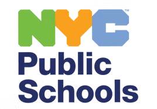

:::: {.page-illustration}
{fig-alt="Illustration of a woman playing the violin next to a music stand"}

[Illustration by [Storyset](https://storyset.com/)]{.small .text-muted}
::::

The Early Childhood Strings Program brings violin instruction into New York City Public Schools classrooms from pre-K through grade 2, with the aim of narrowing early learning gaps, particularly in literacy. Through an ongoing partnership with the NYCPS Arts Office, our team supports the implementation and evaluation of the program. In 2026, we conducted an implementation study to understand how the program is put into practice and the mechanisms through which learning the violin may shape children's learning and development. In 2027, we will conduct an impact study of the program.

**Team:** NYU Institute of Human Development and Social Change (PI: Pamela Morris-Perez)\
**Role:** Graduate Assistant, April 2025–present

::: {.partner-logos}
{fig-alt="NYC Public Schools logo"} {fig-alt="NYC Public Schools Arts Office and Arts Hub logo"}
:::
